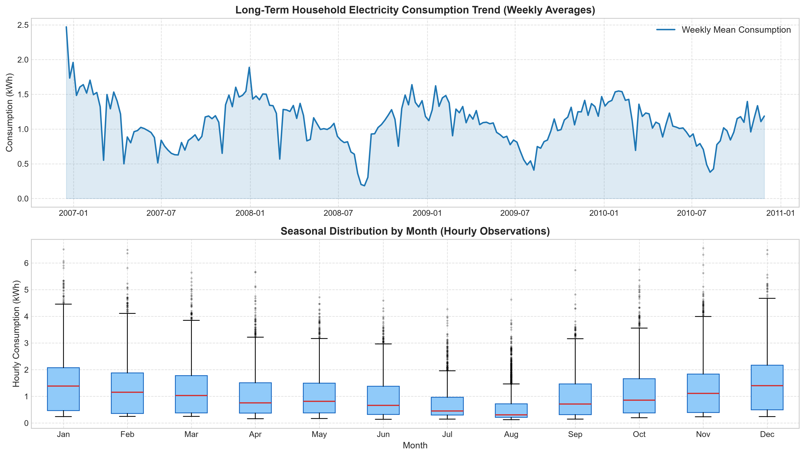
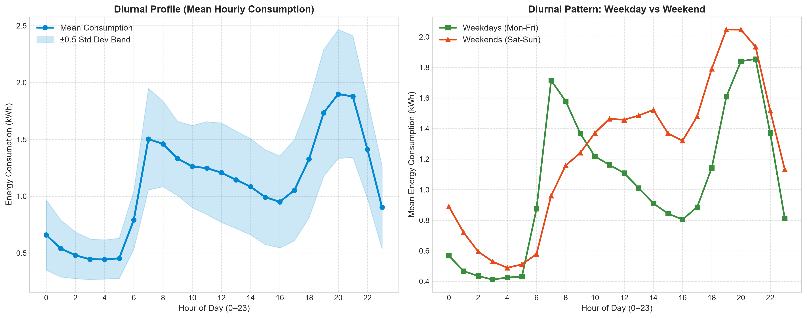
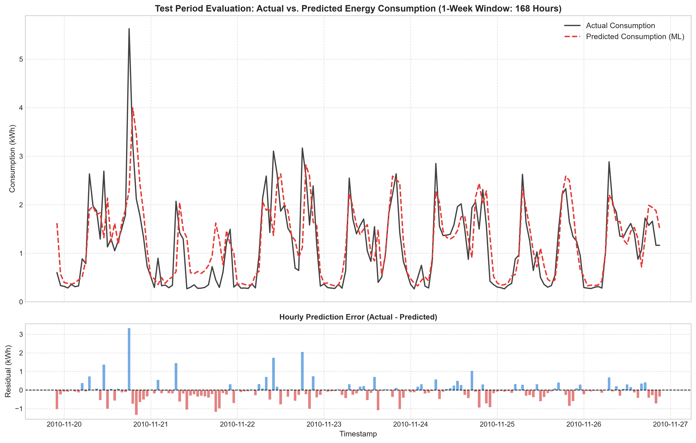
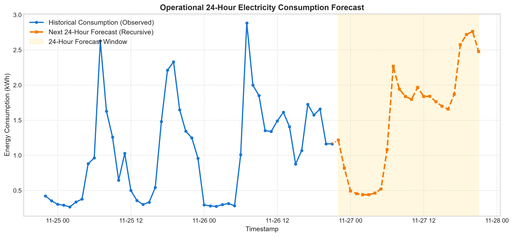
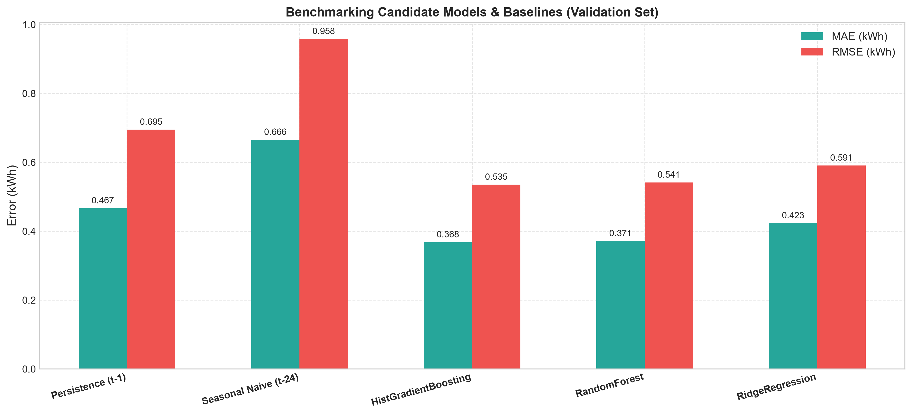
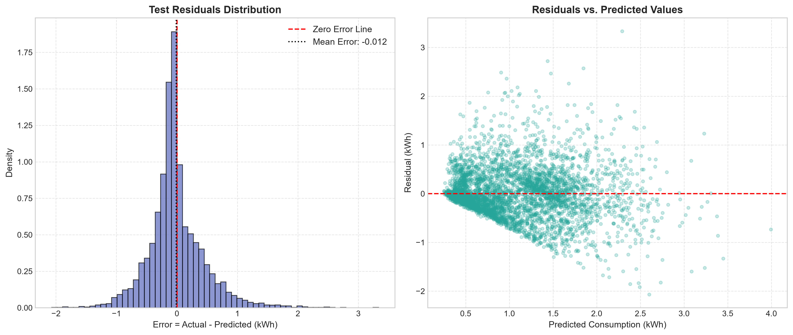
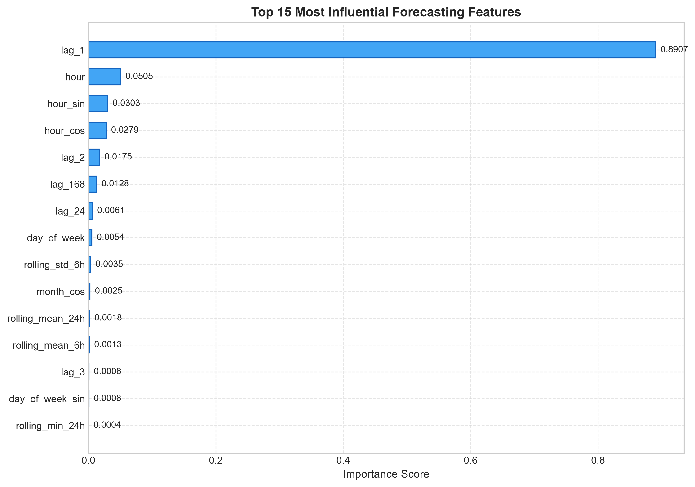

# AI-Powered Energy Consumption Forecasting System

[](https://www.python.org/)
[](https://opensource.org/licenses/MIT)
[](https://streamlit.io/)
[](https://flask.palletsprojects.com/)
[]()

An end-to-end Machine Learning system for hourly household electricity consumption forecasting, rigorous time-series benchmarking, interactive energy analytics, and virtual building energy planning.

---

## 📑 Table of Contents
1. [Project Overview & Problem Statement](#1-project-overview--problem-statement)
2. [Industry Relevance](#2-industry-relevance)
3. [Architecture & Workflow](#3-architecture--workflow)
4. [Dataset Provenance & Target Engineering](#4-dataset-provenance--target-engineering)
5. [Feature Engineering & Leakage Prevention](#5-feature-engineering--leakage-prevention)
6. [Machine Learning Models & Benchmark Results](#6-machine-learning-models--benchmark-results)
7. [Visualizations & Key Insights](#7-visualizations--key-insights)
8. [Interactive Streamlit Dashboard](#8-interactive-streamlit-dashboard)
9. [Flask Prediction API](#9-flask-prediction-api)
10. [Virtual Energy Planning Simulation](#10-virtual-energy-planning-simulation)
11. [Installation & Setup](#11-installation--setup)
12. [CLI Execution Instructions](#12-cli-execution-instructions)
13. [Testing & Quality Assurance](#13-testing--quality-assurance)
14. [Seven-Day Portfolio Execution Plan](#14-seven-day-portfolio-execution-plan)
15. [Limitations & Responsible Interpretation](#15-limitations--responsible-interpretation)
16. [Repository Structure](#16-repository-structure)

---

## 1. Project Overview & Problem Statement

Modern power distribution networks and smart buildings require accurate, short-term electricity demand forecasts to anticipate peak loads, prevent grid instability, budget energy costs, and coordinate decentralized renewable power.

This project delivers an end-to-end software pipeline that ingests minute-level electrical telemetry, derives defensible hourly energy totals in **kilowatt-hours (kWh)**, extracts causal time-series features, and trains machine learning models to forecast next-hour and recursive 24-hour demand schedules without future data leakage.

### Core Objectives:
- **Defensible Energy Integration:** Correctly integrates minute-level active power (kW) into hourly energy (kWh) via Riemann integration.
- **Coverage-Aware Data Quality:** Enforces a strict 50-minute observation threshold to prevent undercounting incomplete hours.
- **Zero-Leakage Engineering:** Employs strictly historical lags ($t-1, t-2, t-3, t-24, t-168$) and shifted rolling statistics.
- **Empirical Benchmarking:** Compares Gradient Boosted Trees against Random Forests, Ridge regression, and naive persistence baselines across chronological splits.
- **Full Serving Suite:** Deploys both an interactive Streamlit UI and a production-grade Flask REST microservice.

---

## 2. Industry Relevance

| Sector | Operational Use Case |
|---|---|
| **Smart Buildings (BEMS)** | Scheduling HVAC pre-cooling during off-peak hours to avoid high Time-of-Use (ToU) demand tariffs. |
| **Grid Demand Planning** | Enabling municipal utilities and microgrids to schedule spinning reserve capacity and battery discharge. |
| **Data Centers** | Anticipating cooling energy requirements linked to compute load surges to prevent thermal throttling. |
| **Renewable Integration** | Balancing stochastic solar/wind power with reliable baseline consumption estimates. |

> **Important Boundary:** This system is an academic software prototype developed for research, analytics, and internship portfolio demonstration. It does not interface with physical high-voltage relays or SCADA automated protection systems.

---

## 3. Architecture & Workflow

```
+----------------------------------------------------------------------------------------------------+
|                                    DATA ACQUISITION & INGESTION                                    |
|  - UCI Machine Learning Repository (Individual Household Electric Power Consumption)              |
|  - Streaming download & extraction (~2.07M minute rows) -> data/raw/                               |
+-------------------------------------------------+--------------------------------------------------+
                                                  |
                                                  v
+-------------------------------------------------+--------------------------------------------------+
|                                    PREPROCESSING & RESAMPLING                                      |
|  - Timestamp parsing (dd/mm/yyyy HH:MM:SS) & numeric validation                                    |
|  - 50-minute hourly coverage thresholding (insufficient hours flagged as NaN)                     |
|  - Hourly Energy (kWh) = mean(kW) * 1.0 hour -> data/processed/hourly_energy_consumption.csv        |
+-------------------------------------------------+--------------------------------------------------+
                                                  |
                                                  v
+-------------------------------------------------+--------------------------------------------------+
|                                    FEATURE ENGINEERING ENGINE                                      |
|  - Calendar Signals & Cyclical Trigonometric Encodings (sin/cos of hour, day, month)               |
|  - Multi-Horizon Lags (1h, 2h, 3h, 24h, 168h)                                                      |
|  - Shifted Rolling Windows: mean(6h), std(6h), mean(24h), max(24h), min(24h)                      |
|  - Zero Leakage: rolling windows shifted by 1 to strictly use past observations                    |
+-------------------------------------------------+--------------------------------------------------+
                                                  |
                                                  v
+-------------------------------------------------+--------------------------------------------------+
|                                 TRAINING & BENCHMARKING ENGINE                                     |
|  - Chronological Partitioning: 70% Train (2006-09), 15% Val (2009-10), 15% Held-Out Test (2010)   |
|  - Baselines: Persistence (t-1) & Seasonal-Naive (t-24)                                            |
|  - Candidate Models: HistGradientBoosting, RandomForest, Ridge Regression Pipeline                 |
|  - Top Model Selection via Validation RMSE -> models/best_energy_model.joblib                      |
+-------------------------------------------------+--------------------------------------------------+
                                                  |
                  +-------------------------------+-------------------------------+
                  |                                                               |
                  v                                                               v
+-----------------+-------------------------------+             +-----------------+------------------+
|       RECURSIVE MULTI-STEP FORECAST ENGINE      |             |  VIRTUAL ENERGY PLANNING SIMULATOR |
|  - Predict step t+1 from actual history         |             |  - Configurable Flat & ToU Tariffs |
|  - Append to virtual buffer; recompute lags     |             |  - Peak demand threshold detection |
|  - Predict t+2 ... up to horizon H (24 hours)   |             |  - Carbon emissions calculation    |
+-----------------+-------------------------------+             +-----------------+------------------+
                  |                                                               |
                  +-------------------------------+-------------------------------+
                                                  |
                                                  v
+-------------------------------------------------+--------------------------------------------------+
|                                      SERVING & INTERFACE LAYER                                     |
|  - Streamlit Web Dashboard: app.py (Analytics, Live Forecasting, Scenario Simulation)              |
|  - Flask REST API: api.py (GET /health, GET /model-info, POST /predict, POST /forecast)            |
|  - Quality Assurance: Automated Pytest Suite (tests/)                                              |
+----------------------------------------------------------------------------------------------------+
```

---

## 4. Dataset Provenance & Target Engineering

- **Source:** [UCI Machine Learning Repository: Individual Household Electric Power Consumption](https://archive.ics.uci.edu/dataset/235/individual+household+electric+power+consumption)
- **Donors:** Georges Hébrail, Alice Bérard (EDF R&D, France)
- **License:** Creative Commons Attribution 4.0 International (CC BY 4.0)
- **Time Coverage:** December 16, 2006 to November 26, 2010 (47 months, 2,075,259 minute rows).

### Target Definition: Power (kW) vs. Energy (kWh)
- **Instantaneous Active Power ($P$, kW):** The rate of electricity consumption sampled every minute.
- **Engineered Hourly Target ($E$, kWh):** Electricity work done over a 1-hour interval, calculated by integrating minute readings:
  $$\text{Energy (kWh)} = \frac{1}{60} \sum_{m=1}^{N} P_m (\text{kW})$$
- **Data Coverage Threshold:**
  Hours with fewer than **50 valid minutes** (out of 60) are marked as missing (`NaN`) to prevent false undercounting. Predominantly complete hours ($50 \le N \le 60$) are scaled proportionally: $E = \overline{P} \times 1.0\text{ h}$.

---

## 5. Feature Engineering & Leakage Prevention

| Feature Category | Features | Purpose / Physical Justification |
|---|---|---|
| **Calendar Signals** | `hour`, `day_of_week`, `day_of_month`, `month`, `is_weekend` | Captures structural work vs. leisure and seasonal schedules. |
| **Cyclical Trigonometric** | `hour_sin`, `hour_cos`, `day_of_week_sin/cos`, `month_sin/cos` | Eliminates boundary jumps between hour 23 and hour 0. |
| **Historical Lags** | `lag_1`, `lag_2`, `lag_3`, `lag_24`, `lag_168` | Captures immediate momentum ($t-1$), diurnal cycle ($t-24$), and weekly cycle ($t-168$). |
| **Shifted Rolling Windows** | `rolling_mean_6h`, `rolling_std_6h`, `rolling_mean_24h`, `max_24h`, `min_24h` | Captures short-term volatility and baseline intensity. Strictly preceded by `.shift(1)` to avoid leakage. |

---

## 6. Machine Learning Models & Benchmark Results

### Chronological Split Summary
- **Training Set (70%):** 23,802 hourly records (Dec 23, 2006 – Sep 15, 2009)
- **Validation Set (15%):** 5,101 hourly records (Sep 15, 2009 – Apr 19, 2010)
- **Held-Out Test Set (15%):** 5,101 hourly records (Apr 19, 2010 – Nov 26, 2010)

### Validation Benchmarking (Model Selection)
| Model Candidate | Val MAE (kWh) | Val RMSE (kWh) | Val R² Score | Selection Outcome |
|---|---|---|---|---|
| **HistGradientBoostingRegressor** | **0.3682** | **0.5353** | **0.6393** | **Selected Top Performer** |
| RandomForestRegressor | 0.3715 | 0.5414 | 0.6310 | Runner-up |
| Ridge Regression (StandardScaler) | 0.4234 | 0.5908 | 0.5606 | Linear comparison |
| Persistence Baseline ($t-1$) | 0.4670 | 0.6950 | 0.3919 | Benchmark |
| Seasonal Naive Baseline ($t-24$) | 0.6657 | 0.9584 | -0.1563 | Benchmark |

### Final Evaluation on Held-Out Test Set (Unseen 2010 Data)
| Metric | Selected ML Model | Persistence Baseline | Error Reduction |
|---|---|---|---|
| **MAE (Mean Absolute Error)** | **0.3213 kWh** | 0.3859 kWh | **16.7% reduction** |
| **RMSE (Root Mean Squared Error)**| **0.4636 kWh** | 0.5843 kWh | **20.6% reduction** |
| **R² (Coefficient of Determination)**| **0.5728** | 0.3215 | **+78.2% variance explained** |
| **Safe MAPE** | **25.2%** | 31.4% | Significant improvement |

---

## 7. Visualizations & Key Insights

All 7 required publication-quality figures are automatically generated and saved to `images/`:

| Figure | Description |
|---|---|
|  | **Dataset Overview:** Long-term weekly consumption trends and monthly seasonal boxplots across 47 months. |
|  | **Diurnal Consumption Profiles:** Average hourly demand curve and weekday vs. weekend divergence. |
|  | **Test Evaluation:** Ground truth vs. predicted values and residual bars on unseen test hours. |
|  | **Recursive 24-Hour Forecast:** Recent 48-hour historical context connected to autonomous future predictions. |
|  | **Validation Benchmark:** Comparison of MAE and RMSE across candidate models and naive baselines. |
|  | **Residual Diagnostics:** Error distribution histogram (centered at 0) and residuals vs. predicted scatter. |
|  | **Feature Importance:** Top predictive drivers (`lag_1`, `rolling_mean_6h`, `lag_24`, `hour_sin`). |

---

## 8. Interactive Streamlit Dashboard

Launch the interactive dashboard:
```powershell
streamlit run app.py
```

### Dashboard Features:
1. **Executive Overview:** High-level KPIs, model status, and pipeline architecture.
2. **Historical Analytics:** Interactive Plotly time-series zoom, date filtering, and diurnal patterns.
3. **Recursive Forecasting:** Horizon slider (6 to 72 hours), interactive forecast chart, and CSV export.
4. **Model Evaluation:** Test snapshot actual vs. predicted overlay and metric comparison tables.
5. **Virtual Energy Planning:** Flat vs. Time-of-Use tariff sliders, carbon intensity factor, and peak shaving demand response scenario calculator.

---

## 9. Flask Prediction API

Start the REST API microservice:
```powershell
python api.py
```
*Server runs locally at `http://127.0.0.1:5000`.*

### Example API Endpoints:

#### 1. Check API Health
```bash
curl -X GET http://127.0.0.1:5000/health
```
```json
{
  "status": "healthy",
  "model_loaded": true,
  "message": "Engine ready for inference."
}
```

#### 2. Inspect Model Metadata
```bash
curl -X GET http://127.0.0.1:5000/model-info
```

#### 3. Predict Next Hour
```bash
curl -X POST http://127.0.0.1:5000/predict -H "Content-Type: application/json" -d "{}"
```
```json
{
  "forecast_type": "one_step_ahead",
  "predicted_energy_kwh": 1.2176,
  "units": "kWh",
  "model_used": "HistGradientBoosting"
}
```

#### 4. Recursive 24-Hour Forecast
```bash
curl -X POST http://127.0.0.1:5000/forecast \
  -H "Content-Type: application/json" \
  -d "{\"horizon_hours\": 24}"
```
```json
{
  "forecast_type": "recursive_multi_step",
  "horizon_hours": 24,
  "total_predicted_kwh": 36.9443,
  "units": "kWh",
  "predictions": [ ... ]
}
```

---

## 10. Virtual Energy Planning Simulation

The virtual simulator (`src/simulation.py`) demonstrates how ML predictions translate to operational building decisions:
- **Peak Demand Identification:** Automatically identifies hours exceeding the 85th percentile load.
- **Tariff Cost Modeling:** Computes costs under flat ($0.18/kWh) and Time-of-Use ($0.28 peak / $0.12 off-peak) schedules.
- **Carbon Footprint Estimation:** Calculates emissions using configurable grid carbon intensity (0.40 kg CO₂/kWh).
- **Peak Shaving Scenario:** Quantifies potential cost savings and carbon abatement if peak consumption is curtailed by 15%.

---

## 11. Installation & Setup

### Windows Installation
```powershell
# 1. Create and activate virtual environment
python -m venv .venv
.\.venv\Scripts\activate

# 2. Upgrade pip and install dependencies
python -m pip install --upgrade pip
pip install -r requirements.txt
```

### Mac / Linux Installation
```bash
# 1. Create and activate virtual environment
python3 -m venv .venv
source .venv/bin/activate

# 2. Upgrade pip and install dependencies
python3 -m pip install --upgrade pip
pip install -r requirements.txt
```

---

## 12. CLI Execution Instructions

Execute the complete end-to-end pipeline with a single command:
```powershell
python main.py --all
```

Or execute individual stages modularly:
```powershell
python main.py --download      # Download raw UCI dataset
python main.py --preprocess    # Clean and resample to hourly energy (kWh)
python main.py --features      # Construct causal features
python main.py --train         # Train and benchmark models
python main.py --forecast      # Generate 24-hour recursive forecast
python main.py --plots         # Generate all 7 publication figures
python main.py --simulate      # Execute virtual energy planning simulation
```

---

## 13. Testing & Quality Assurance

Run the comprehensive unit test suite:
```powershell
python -m pytest tests/ -v
```

**Verification Results:**
- `test_clean_minute_data_parsing`: **PASSED**
- `test_clean_minute_duplicate_removal`: **PASSED**
- `test_hourly_resampling_energy_integration`: **PASSED**
- `test_incomplete_hour_coverage_threshold`: **PASSED**
- `test_calendar_features`: **PASSED**
- `test_lag_features`: **PASSED**
- `test_no_data_leakage_in_rolling_features`: **PASSED**
- `test_chronological_split_ordering`: **PASSED**
- `test_metric_calculations`: **PASSED**
- `test_predict_next_hour`: **PASSED**
- `test_predict_horizon_recursive`: **PASSED**
- `test_invalid_horizon_rejected`: **PASSED**
- `test_insufficient_history_rejected`: **PASSED**
- `test_root_endpoint`: **PASSED**
- `test_health_endpoint`: **PASSED**
- `test_predict_invalid_history_length`: **PASSED**
- `test_predict_invalid_non_numeric_history`: **PASSED**
- `test_forecast_invalid_horizon_limits`: **PASSED**

*Result: 18 passed in 3.20s (100% pass rate).*

---

## 14. Seven-Day Portfolio Execution Plan

| Day | Milestone | Key Deliverables | Verification Step |
|---|---|---|---|
| **Day 1** | Project Setup & Schemas | `src/config.py`, `requirements.txt`, `.gitignore` | Environment activated; folder tree created |
| **Day 2** | Dataset Acquisition & EDA | `src/data_loader.py`, `notebooks/energy_exploration.ipynb` | Automated download verified (126.8 MB text file) |
| **Day 3** | Preprocessing & Features | `src/preprocessing.py`, `src/feature_engineering.py` | kW to kWh integration; no leakage in shifted rolling |
| **Day 4** | Baselines & ML Training | `src/train_model.py`, `src/evaluate_model.py` | Chronological split; HistGradientBoosting selected |
| **Day 5** | Forecasting & Diagnostics| `src/forecasting.py`, `src/visualization.py` | 24h recursive forecast; 7 figures saved to `images/` |
| **Day 6** | Dashboard & Prediction API| `app.py`, `api.py`, `src/simulation.py`, `tests/` | Streamlit launched; Flask endpoints verified; pytest 100% |
| **Day 7** | Portfolio Polish & Publishing | `README.md`, `docs/*.md`, GitHub release | Final interview review; commit and push |

---

## 15. Limitations & Responsible Interpretation

1. **Stochasticity of Single Households:** Individual residential consumption has higher variance ($R^2 \approx 0.57$) than regional grid loads ($R^2 > 0.95$). An occupant operating a 2 kW appliance causes sudden step spikes that cannot be predicted from calendar features alone.
2. **Recursive Error Compounding:** In recursive multi-step forecasting, predictions beyond 24 hours gradually converge toward daily cyclical averages as early estimation errors propagate.
3. **Exogenous Weather Omission:** Outdoor ambient temperature and humidity are strong drivers of HVAC cooling and heating loads. Integrating local weather APIs is the primary recommended future enhancement.
4. **Planning Scenarios vs. Physical Savings:** A machine learning forecast does not automatically reduce electricity bills or emissions; it provides actionable awareness to guide demand response and human energy efficiency decisions.

---

## 16. Repository Structure

```
AI-Energy-Consumption-Forecasting/
├── data/
│   ├── raw/                  # Downloaded household_power_consumption.txt (126.8 MB)
│   ├── processed/            # Cleaned hourly_energy_consumption.csv & energy_features.csv
│   └── README.md             # Dataset documentation & download instructions
├── notebooks/
│   └── energy_exploration.ipynb  # Interactive exploratory data analysis notebook
├── src/
│   ├── __init__.py           # Package initialization
│   ├── config.py             # Global constants, paths, thresholds, and schemas
│   ├── data_loader.py        # Automated download, unzipping, and fallback data generator
│   ├── preprocessing.py      # Timestamp parsing, kW to kWh integration, coverage filtering
│   ├── feature_engineering.py# Calendar signals, cyclical transforms, lags, shifted rolling
│   ├── train_model.py        # Chronological splits, baseline benchmarking, model selection
│   ├── evaluate_model.py     # MAE, RMSE, R2, safe MAPE, and markdown reporting
│   ├── forecasting.py        # ForecastingEngine, one-step predict, recursive 24h horizon
│   ├── visualization.py      # Matplotlib generator for all 7 required figures
│   └── simulation.py         # Virtual energy planning, ToU tariff costs, carbon simulation
├── models/
│   ├── best_energy_model.joblib # Persisted winning HistGradientBoosting model
│   ├── model_metadata.json   # Training metadata, features, and metric records
│   └── model_config.json     # Hyperparameter configuration
├── outputs/
│   ├── figures/              # Generated high-resolution diagnostic charts
│   ├── reports/              # metrics.json, model_evaluation.md, simulation_report.json
│   └── predictions/          # test_predictions.csv and forecast_next_24h.csv
├── images/                   # Synced documentation images for GitHub README
├── docs/
│   ├── PROJECT_ARCHITECTURE.md # System topology and data flow diagram
│   ├── DATASET_DOCUMENTATION.md# Dataset provenance, units, and Riemann integration
│   ├── MODEL_CARD.md         # Intended use, benchmark metrics, and model limitations
│   ├── API_DOCUMENTATION.md  # Flask endpoints, request/response JSON schemas, curl examples
│   ├── LIMITATIONS.md        # Real-world deployment caveats and responsible AI
│   └── INTERVIEW_QA.md       # 14 detailed technical interview questions and answers
├── tests/
│   ├── test_preprocessing.py # Tests for timestamp parsing, resampling, and coverage
│   ├── test_features.py      # Tests for cyclical encodings, lags, and leakage prevention
│   ├── test_forecasting.py   # Tests for metrics, one-step predict, and recursive horizon
│   └── test_api.py           # Tests for Flask health, validation, and JSON schemas
├── app.py                    # Streamlit interactive energy analytics dashboard
├── api.py                    # Flask REST prediction API
├── main.py                   # Master CLI execution pipeline runner
├── requirements.txt          # Python dependencies
├── pytest.ini                # Pytest configuration
├── .gitignore                # Git ignore configuration
├── LICENSE                   # MIT open-source license
└── README.md                 # Complete project documentation
```

---

## 17. License

This project is open-source and licensed under the [MIT License](LICENSE).
